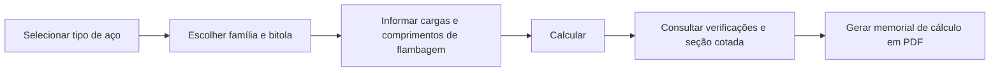

# Dimensionamento de Perfis Metálicos (Soldados e Laminados) - ABNT NBR 8800:2024

Versão atual: **0.1.5**

Aplicativo desktop para o dimensionamento à compressão de perfis de aço,
conforme a **ABNT NBR 8800:2024**.

O projeto oferece uma interface gráfica para selecionar perfis laminados
(W/HP) ou soldados (CS), definir o aço e as condições de flambagem, conferir
o resultado e gerar um memorial de cálculo em PDF.

O desenvolvimento desta ferramenta permite automatizar os procedimentos de
verificação de perfis metálicos submetidos à compressão e auxiliar na escolha
de uma seção transversal adequada às condições consideradas. A aplicação pode
ser útil, por exemplo, em situações de reforço estrutural que utilizem um
perfil de aço e exijam a avaliação de uma seção compatível com os critérios de
dimensionamento.

O projeto também responde à atualização da **ABNT NBR 8800**, publicada em
2024, que trouxe mudanças nos procedimentos de dimensionamento de elementos
de aço comprimidos em relação à versão anterior. Dessa forma, a ferramenta
busca acompanhar os critérios da norma vigente e fornecer cálculos alinhados
às exigências atualmente estabelecidas.

## Recursos

- Dimensionamento de perfis de aço submetidos à compressão axial.
- Catálogo de perfis **laminados (W/HP)** e **soldados (CS)**.
- Catálogo de tipos de aço com propriedades `fy` e `fu`.
- Cadastro, salvamento, duplicação e exclusão de projetos.
- Visualização cotada da seção transversal do perfil.
- Destaque interativo das cotas ao passar o mouse sobre as dimensões.
- Consulta de propriedades geométricas e ordenação numérica das bitolas.
- Geração automática do memorial de cálculo em PDF na pasta **Downloads**.
- Interface em português, com tema claro.

> O memorial de cálculo é gerado a partir dos mesmos dados e da mesma
> geometria utilizados na interface. Alterações visuais na interface não
> modificam as fórmulas nem o conteúdo técnico do cálculo.

## PROA.lab

Este aplicativo está vinculado ao **PROA.lab — Laboratório de Programação e
Análise de Estruturas**, uma iniciativa de extensão do **IFCE Campus
Quixadá**. O projeto desenvolve e disponibiliza gratuitamente ferramentas
computacionais para a Engenharia Civil, com foco em Estruturas.

Além de apoiar profissionais na automatização de rotinas de análise e projeto,
as ferramentas do PROA.lab aproximam acadêmicos da prática de engenharia,
fortalecendo a relação entre os conceitos estudados e sua aplicação técnica.
O nome remete à Programação e Análise de Estruturas e à proa de uma
embarcação, simbolizando a iniciativa diante dos desafios da área. O sufixo
`.lab` reforça a natureza computacional do projeto e sua visão de consolidar,
no futuro, um espaço permanente de inovação e pesquisa aplicada.

## Tecnologias

- Python
- PySide6
- SQLite
- FPDF2
- OpenPyXL
- Pytest

## Requisitos

- Python **3.12** ou superior recomendado.
- `pip`
- Windows, Linux ou macOS para executar pelo código-fonte.

## Instalação

Clone o repositório e entre na pasta do projeto:

```bash
git clone https://github.com/SilasLLopes/dimensionamento.git
cd dimensionamento
```

Crie e ative um ambiente virtual.

### Windows (PowerShell)

```powershell
python -m venv .venv
.\.venv\Scripts\Activate.ps1
python -m pip install --upgrade pip
pip install -r requirements.txt
```

### Linux/macOS

```bash
python3 -m venv .venv
source .venv/bin/activate
python -m pip install --upgrade pip
pip install -r requirements.txt
```

## Preparação do catálogo

Na primeira execução, importe a planilha de referência para criar o arquivo
local `catalogo.db`:

```bash
python -m app.importers.excel_importer "ELU Compressão.xlsx" catalogo.db
```

O banco SQLite é criado na raiz do projeto e não é versionado. A planilha
`ELU Compressão.xlsx` é a fonte inicial dos tipos de aço e dos perfis.

## Executando o aplicativo

```bash
python -m app.main
```

O aplicativo abre maximizado e apresenta quatro áreas principais:

| Área | Finalidade |
| --- | --- |
| **Projetos** | Criar, salvar, duplicar, excluir e calcular projetos. |
| **Detalhes do Perfil** | Visualizar a seção cotada, dimensões e propriedades do perfil selecionado. |
| **Catálogo de Perfis** | Consultar perfis laminados e soldados por família. |
| **Tipos de Aço** | Consultar as propriedades dos aços cadastrados. |

### Fluxo de uso

1. Crie um projeto ou selecione um projeto existente.
2. Escolha o tipo de aço, a família e a bitola.
3. Informe a carga de cálculo e os parâmetros de flambagem.
4. Clique em **Calcular**.
5. Consulte os resultados e gere o PDF pela opção **PDF**.

### Fluxo do dimensionamento



## Testes

Execute a suíte de testes com:

```bash
pytest -q
```

Os testes de regressão verificam o motor de cálculo com casos extraídos da
planilha de referência.

## Empacotamento para Windows

O projeto inclui uma especificação do PyInstaller em
[`packaging/pyinstaller.spec`](packaging/pyinstaller.spec).

O workflow [`.github/workflows/build-windows.yml`](.github/workflows/build-windows.yml)
gera o pacote Windows automaticamente quando uma tag no formato `vX.Y.Z` é
enviada ao repositório. Um simples push na branch `master` **não** cria uma
release.

## Estrutura do projeto

```text
app/
├── db/                 # Esquema e conexão com SQLite
├── domain/             # Modelos, cálculos e geometria da seção
├── importers/          # Importação da planilha Excel para o SQLite
├── report/             # Geração do memorial de cálculo em PDF
├── ui/                 # Interface PySide6
├── main.py             # Ponto de entrada do aplicativo
└── repositories.py     # Acesso aos dados do catálogo e dos projetos
tests/                  # Testes automatizados
packaging/              # Configuração do PyInstaller
```

## Arquitetura

As fórmulas de dimensionamento estão concentradas em
[`app/domain/calculations.py`](app/domain/calculations.py). A geometria da
seção é produzida em
[`app/domain/drawing.py`](app/domain/drawing.py) e reutilizada tanto pela
interface quanto pelo memorial PDF. Dessa forma, a lógica geométrica não é
duplicada entre a tela e o relatório.

## Referência

Os cálculos foram estruturados a partir dos scripts históricos
`Codigocompleto.py` e `CodigocomPDF.py`, mantidos no repositório como
referência, e da planilha `ELU Compressão.xlsx`.

Este software é uma ferramenta de apoio ao dimensionamento. A validação final
do projeto e a responsabilidade técnica permanecem com o profissional
habilitado.
