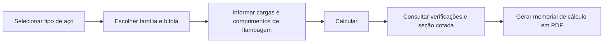

# StructDim — Dimensionamento de Perfis de Aço

Versão atual: **0.1.7**


O **StructDim** é um software de uso educacional para o estudo do
dimensionamento à compressão de perfis de aço, com base nos critérios da
**ABNT NBR 8800:2024**. Seu nome combina *Structure* (estrutura, em inglês) e
dimensionamento, sintetizando o tema abordado pelo aplicativo.

Por meio de uma interface gráfica, estudantes podem selecionar perfis
laminados (W/HP) ou soldados (CS), definir o tipo de aço e as condições de
flambagem, acompanhar as verificações e gerar um memorial de cálculo em PDF.
O aplicativo busca aproximar os conceitos estudados em sala de aula de sua
aplicação em exemplos de dimensionamento.

Os critérios implementados consideram a edição de 2024 da **ABNT NBR 8800**.
O uso do aplicativo é educacional: os resultados servem para estudo e não
substituem a consulta à norma, a análise das hipóteses adotadas ou a validação
dos cálculos em cada contexto.

## Recursos

- Aba inicial apresenta o propósito educacional do StructDim e orienta o primeiro uso.
- Dimensionamento de perfis de aço submetidos à compressão axial.
- Explicação passo a passo dos resultados, com expressões implementadas e
  referências temáticas à norma.
- Catálogo de perfis **laminados (W/HP)** e **soldados (CS)**.
- Catálogo de tipos de aço com propriedades `fy` e `fu`.
- Cadastro, salvamento, duplicação e exclusão de projetos.
- Visualização cotada da seção transversal do perfil.
- Destaque interativo das cotas ao passar o mouse sobre as dimensões.
- Consulta de propriedades geométricas e ordenação numérica das bitolas.
- Geração automática do memorial de cálculo em PDF na pasta **Downloads**.
- Ao gerar outro memorial para a mesma bitola, um sufixo numérico é acrescentado
  ao nome do arquivo para preservar os PDFs anteriores.
- Interface em português, com tema claro.

> O memorial de cálculo é gerado a partir dos mesmos dados e da mesma
> geometria utilizados na interface. Alterações visuais na interface não
> modificam as fórmulas nem o conteúdo técnico do cálculo.

O passo a passo e as expressões também são incluídos no memorial PDF para fins
educacionais. Consulte a edição oficial da norma para confirmar a aplicação de
cada equação.

### Novidades

- O índice de esbeltez reduzido (λ₀) aparece antes do fator de redução (χ)
  nos resultados e no memorial PDF, conforme o passo a passo.
- O botão **Novo** não recebe mais um contorno azul automático ao obter foco.

## Script de terminal de referência

Além do aplicativo gráfico, o repositório mantém
[`CodigocomPDF.py`](CodigocomPDF.py), um script independente de linha de
comando, derivado da implementação histórica do dimensionamento. Ele não abre
o StructDim nem usa o catálogo SQLite: lê diretamente a planilha
`ELU Compressão.xlsx`, que deve estar na pasta de execução.

Com o ambiente virtual ativado e as dependências do projeto instaladas, instale
também as dependências específicas do script:

```bash
python -m pip install pandas pick
```

Execute o script a partir da raiz do repositório:

```bash
python CodigocomPDF.py
```

O fluxo interativo solicita o nome do responsável pelo memorial, a família e a
bitola do perfil, o tipo de aço e os dados de cálculo. Informe `Ea` e `Ga` em
GPa, a força axial em kN, os comprimentos destravados em metros e os fatores
`Kx`, `Ky` e `Kz` conforme as condições de flambagem. Ao final, o memorial PDF
é salvo na pasta de execução com o nome `Memorial_Compressao_<perfil>.pdf`.

Esse script é mantido para referência e execução independente; não é o ponto de
entrada do aplicativo gráfico. Para usar a interface, siga as instruções de
[execução do aplicativo](#executando-o-aplicativo).

## O nome StructDim e o PROA.lab

O StructDim foi desenvolvido no contexto do **PROA.lab — Laboratório de
Programação e Análise de Estruturas**, projeto de extensão do **IFCE Campus
Quixadá**. A iniciativa propõe desenvolver e disponibilizar gratuitamente
ferramentas computacionais para a Engenharia Civil, especialmente para o
estudo de Estruturas. Seus recursos têm finalidade educacional e buscam
fortalecer a relação entre teoria e prática na formação acadêmica.

O nome **PROA** reúne referência à Programação e Análise de Estruturas e à
proa de uma embarcação, símbolo de avanço diante dos desafios da Engenharia.
O sufixo **.lab**, inspirado nas extensões de arquivos digitais, destaca o
caráter computacional da iniciativa. Além do desenvolvimento de software, o
PROA.lab tem como perspectiva contribuir para a consolidação de uma cultura
técnica e científica e, futuramente, de um espaço permanente de inovação e
pesquisa aplicada no campus.

## Tecnologias

- Python
- PySide6
- SQLite
- FPDF2
- OpenPyXL
- Pytest

## Requisitos

- Python **3.12** ou superior recomendado.
- `pip`
- Windows, Linux ou macOS para executar pelo código-fonte.

## Instalação

Clone o repositório e entre na pasta do projeto:

```bash
git clone https://github.com/ClarissaFerreiraS/dimensionamentoperfis.git
cd dimensionamentoperfis
```

Crie e ative um ambiente virtual.

### Windows (PowerShell)

```powershell
python -m venv .venv
.\.venv\Scripts\Activate.ps1
python -m pip install --upgrade pip
pip install -r requirements.txt
```

### Linux/macOS

```bash
python3 -m venv .venv
source .venv/bin/activate
python -m pip install --upgrade pip
pip install -r requirements.txt
```

## Preparação do catálogo

Na primeira execução, importe a planilha de referência para criar o arquivo
local `catalogo.db`:

```bash
python -m app.importers.excel_importer "ELU Compressão.xlsx" catalogo.db
```

O banco SQLite é criado na raiz do projeto e não é versionado. A planilha
`ELU Compressão.xlsx` é a fonte inicial dos tipos de aço e dos perfis.

## Executando o aplicativo

```bash
python -m app.main
```

O aplicativo abre maximizado e apresenta quatro áreas principais:

| Área | Finalidade |
| --- | --- |
| **Projetos** | Criar, salvar, duplicar, excluir e calcular projetos. |
| **Detalhes do Perfil** | Visualizar a seção cotada, dimensões e propriedades do perfil selecionado. |
| **Catálogo de Perfis** | Consultar perfis laminados e soldados por família. |
| **Tipos de Aço** | Consultar as propriedades dos aços cadastrados. |

### Fluxo de uso

1. Crie um projeto ou selecione um projeto existente.
2. Escolha o tipo de aço, a família e a bitola.
3. Informe a carga de cálculo e os parâmetros de flambagem.
4. Clique em **Calcular**.
5. Consulte os resultados e gere o PDF pela opção **PDF**.

### Fluxo do dimensionamento



## Testes

Execute a suíte de testes com:

```bash
pytest -q
```

Os testes de regressão verificam o motor de cálculo com casos extraídos da
planilha de referência.

## Empacotamento para Windows

O projeto inclui uma especificação do PyInstaller em
[`packaging/pyinstaller.spec`](packaging/pyinstaller.spec).

O workflow [`.github/workflows/build-windows.yml`](.github/workflows/build-windows.yml)
gera o pacote Windows automaticamente quando uma tag no formato `vX.Y.Z` é
enviada ao repositório. A tag deve corresponder à versão em `app/__init__.py`:
por exemplo, `v0.1.7` gera `StructDim-v0.1.7.zip`. O ZIP para Windows contém o
`StructDim.exe`, o catálogo e os arquivos necessários para executar a aplicação.
Um simples push na branch `master` **não** cria uma release.

## Estrutura do projeto

```text
app/
├── db/                 # Esquema e conexão com SQLite
├── domain/             # Modelos, cálculos e geometria da seção
├── importers/          # Importação da planilha Excel para o SQLite
├── report/             # Geração do memorial de cálculo em PDF
├── ui/                 # Interface PySide6
├── main.py             # Ponto de entrada do aplicativo
└── repositories.py     # Acesso aos dados do catálogo e dos projetos
tests/                  # Testes automatizados
packaging/              # Configuração do PyInstaller
```

## Arquitetura

As fórmulas de dimensionamento estão concentradas em
[`app/domain/calculations.py`](app/domain/calculations.py). A geometria da
seção é produzida em
[`app/domain/drawing.py`](app/domain/drawing.py) e reutilizada tanto pela
interface quanto pelo memorial PDF. Dessa forma, a lógica geométrica não é
duplicada entre a tela e o relatório.

## Referência

Os cálculos foram estruturados a partir dos scripts históricos
`Codigocompleto.py` e `CodigocomPDF.py`, mantidos no repositório como
referência, e da planilha `ELU Compressão.xlsx`. O StructDim é destinado ao
estudo; seus resultados devem ser interpretados considerando os dados de
entrada, as hipóteses adotadas e os limites dos critérios implementados.
